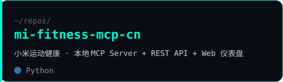
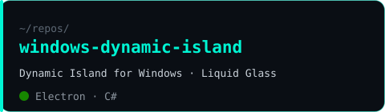
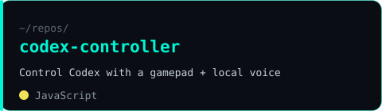
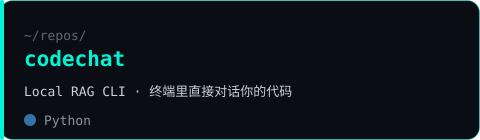

<div align="center">



<a href="https://git.io/typing-svg"></a>

</div>

```bash
$ cat about.txt
> 中文：学生开发者，专注做在本地运行的 AI 工具 —— MCP、RAG、Agent 与桌面交互。
> EN:   Student developer building local-first AI tools — MCP servers, RAG CLIs, agents & desktop UX.
```

## `> featured_projects`

<table>
<tr><td width="50%"><a href="https://github.com/HUAYUE1024/mi-fitness-mcp-cn"></a><br/><a href="https://github.com/HUAYUE1024/mi-fitness-mcp-cn/stargazers"></a></td><td width="50%"><a href="https://github.com/HUAYUE1024/windows-dynamic-island"></a><br/><a href="https://github.com/HUAYUE1024/windows-dynamic-island/stargazers"></a></td></tr>
<tr><td width="50%"><a href="https://github.com/HUAYUE1024/codex-controller"></a><br/><a href="https://github.com/HUAYUE1024/codex-controller/stargazers"></a></td><td width="50%"><a href="https://github.com/HUAYUE1024/codechat"></a><br/><a href="https://github.com/HUAYUE1024/codechat/stargazers"></a></td></tr>
</table>

<sub>also → <a href="https://github.com/HUAYUE1024/huaycode">huaycode</a> (Python execution visualizer) · <a href="https://github.com/HUAYUE1024/Snowcode">Snowcode</a> (更好的 Agent) · <a href="https://github.com/HUAYUE1024/MoCobe">MoCobe</a> (AI agent platform)</sub>

## `> tech_stack`

<p align="center"></p>

## `> stats --live`

<p align="center">


</p>
<p align="center"></p>

<picture>
  <source media="(prefers-color-scheme: dark)" srcset="https://raw.githubusercontent.com/HUAYUE1024/HUAYUE1024/output/github-snake-dark.svg"/>
  
</picture>

---
<p align="center"><code>$ exit 0</code> · <sub>local-first, always.</sub></p>
